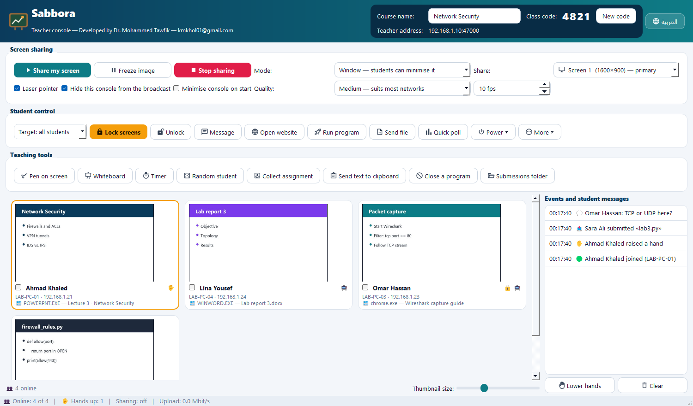
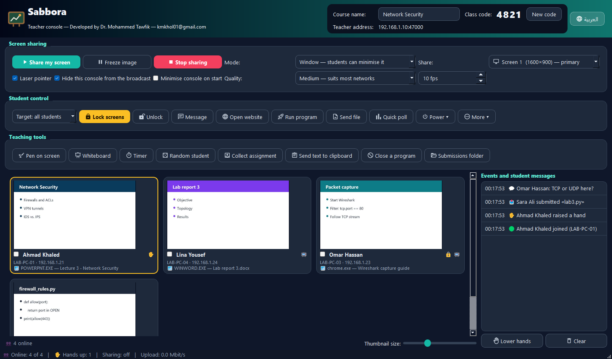
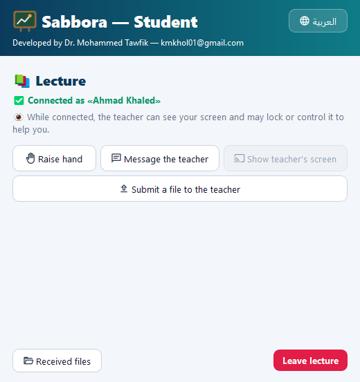
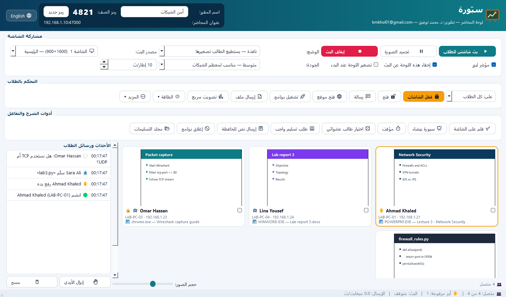

<div align="center">


# Sabbora · سبّورة

**Classroom screen sharing and control for computer labs: share your screen or just your PowerPoint, watch every student, lock, message, send files, collect assignments. Arabic and English, offline, zero setup.**

[Download v1.2](https://github.com/kmkholm/Sabbora/releases/latest) · [العربية](#العربية) · MIT licence



</div>

## Why Sabbora

Lab tools such as Veyon are powerful, but you have to set them up first: key pairs, a list of computers, and a background service on every PC. Sabbora needs none of that:

- **Two standalone `.exe` files.** One is for the teacher, one for the students. Nothing to install, no Python, no internet; the PCs only need to be on the same LAN.
- **Students find the teacher automatically** and join with a 4-digit class code.
- **Arabic and English.** One click switches the language, and the layout flips between right-to-left and left-to-right.

## Features

| Area | What you get |
|---|---|
| **Share** | **Whole screen**, **one window** (students see only that window even when others cover it), or **PowerPoint auto-follow**: the slide show while it runs (F5), otherwise the PowerPoint window. Locked full-screen or windowed mode, freeze, laser pointer, 5 quality presets, multi-monitor, a console hidden from the broadcast, and a floating control bar |
| **Watch** | Live thumbnails of every student, plus the program each student is using right now. Double-click for a high-resolution live view and **remote control** (mouse and keyboard). Show one student's screen to the whole class |
| **Control** | Lock screens (keyboard blocked), message, open website, run program, close program, send files (up to 512 MB), shut down / restart / log off, Wake-on-LAN, disconnect |
| **Teach** | Pen and highlighter over any program (students see the ink), white/green whiteboard, countdown timer on student PCs, random student picker, quick polls with live results, text to the students' clipboard |
| **Collect** | "Collect assignment": students submit files, which are saved per course and date. Raised hands and student questions appear live |
| **Admin** | Attendance CSV with minutes present, snapshots of all screens, a saved room roster, auto-reconnect, lab autostart (`--auto`) and `--selftest` |
| **Look** | Material Design icons and three themes: Modern, Classic green and Dark |

<p align="center">


</p>

## Quick start

1. **Teacher PC:** run `SabboraTeacher.exe`. The top bar shows the **class code** and the **teacher address**.
2. **Student PCs:** run `SabboraStudent.exe`, type a name, pick the lecture (found automatically), type the code and click **Join lecture**.
3. On first run, allow the app through Windows Firewall, or run `Firewall_Teacher.cmd` / `Firewall_Student.cmd` once as administrator.

Presenting PowerPoint: set **Share → PowerPoint — follows the slide show**, then **Share my screen**.

Lab autostart:

```
SabboraStudent.exe --auto --code 4821 --name "PC-01"
```

Check a PC: `SabboraStudent.exe --selftest` writes PASS or FAIL to `%LOCALAPPDATA%\Sabbora\selftest_student.txt`.

## Requirements

- Windows 10 or 11 (64-bit).
- Network ports: TCP 47000 (class connection) and UDP 47001 (auto-discovery).
- Students are always told, in the window and the tray icon, that the teacher can see their screen while connected.
- Ctrl+Alt+Del is never blocked.

## Build from source

```
pip install -r requirements.txt
python run_teacher.py          # or run_student.py
python -m pytest tests -q      # 35 tests: every feature in a live teacher-student session
Build_EXE.cmd                  # dist\SabboraTeacher.exe and dist\SabboraStudent.exe
```

The project is about 4,800 lines of Python: PyQt5, QtWebSockets and Pillow. Frames use a latest-frame-wins JPEG stream with acknowledgements, so a slow PC never slows the others, and unchanged screens are not resent.

| Path | Contents |
|---|---|
| `sabbora/common.py` | Protocol, capture (screen and window), input, language, themes |
| `sabbora/teacher.py`, `sabbora/teacher_tools.py` | Teacher console, pen overlay, window picker |
| `sabbora/student.py` | Student agent |
| `sabbora/icons.py` | Themed icons |

---

<div dir="rtl">

## العربية

**سبّورة** برنامج لإدارة قاعات الحاسوب. يبث شاشة المحاضر، أو عرض PowerPoint وحده، إلى أجهزة الطلاب، ويعرض كل شاشات الطلاب أمام المحاضر مع تحكم كامل. يعمل بلا إنترنت وبلا تثبيت وبلا أي إعداد.

<p align="center"></p>

### التشغيل

1. **جهاز المحاضر:** شغّل `SabboraTeacher.exe`. يظهر في الأعلى **رمز الصف** و**عنوان المحاضر**.
2. **أجهزة الطلاب:** شغّل `SabboraStudent.exe`. يكتب الطالب اسمه، ويختار المحاضرة التي تظهر تلقائيًا، ثم يكتب الرمز ويضغط «دخول المحاضرة».
3. عند أول تشغيل اسمح للبرنامج في جدار الحماية، أو شغّل `Firewall_Teacher.cmd` و`Firewall_Student.cmd` مرة واحدة.

**عرض PowerPoint:** من «مصدر البث» اختر «PowerPoint — يتبع العرض تلقائيًا» ثم اضغط «بث شاشتي». يرى الطلاب الشرائح فقط.

### الميزات

- **البث:** يمكنك بث الشاشة كاملة، أو نافذة واحدة، أو PowerPoint تلقائيًا.
  - يمكن أن يكون البث بملء الشاشة مقفلًا أو في نافذة.
  - تتوفر أيضًا خيارات تجميد الصورة، ومؤشر ليزر، وخمسة مستويات للجودة.
- **المراقبة:** صورة حية لكل طالب مع اسم البرنامج المفتوح عنده.
  - تشاهد أي طالب بدقة عالية وتتحكم بجهازه عن بعد.
  - تستطيع عرض شاشة أي طالب على الصف كله.
- **التحكم:** القفل، والرسائل، وفتح المواقع، وتشغيل البرامج وإغلاقها، وإرسال الملفات، والطاقة، وتشغيل الأجهزة عن بعد (Wake-on-LAN).
- **أدوات الشرح:** قلم وتظليل فوق أي برنامج، وسبورة بيضاء أو خضراء، ومؤقت تنازلي، واختيار طالب عشوائي، وتصويت سريع، وإرسال نص إلى حافظة الطلاب.
- **الواجبات:** «طلب تسليم واجب»، وتُحفظ التسليمات حسب المقرر والتاريخ. ويستطيع الطلاب رفع أيديهم وإرسال أسئلة.
- **الإدارة:** كشف حضور CSV فيه مدة الحضور، ولقطات لكل الشاشات، وعودة تلقائية للاتصال، وتشغيل تلقائي في المختبر.
- **المظهر:** العربية والإنجليزية، وأيقونات احترافية، وثلاثة أنماط ألوان.

### الخصوصية والشفافية

يرى الطالب دائمًا تنبيهًا بأن المحاضر يستطيع رؤية شاشته أثناء الاتصال، ولا يُحجب Ctrl+Alt+Del أبدًا.

</div>

---

**Developed by Dr. Mohammed Tawfik** · kmkhol01@gmail.com · ORCID [0009-0004-7622-5991](https://orcid.org/0009-0004-7622-5991)
